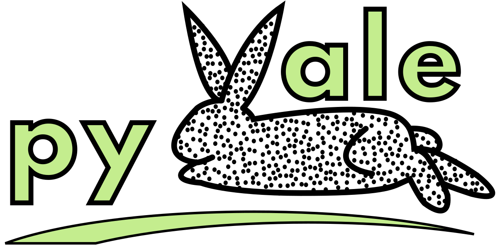
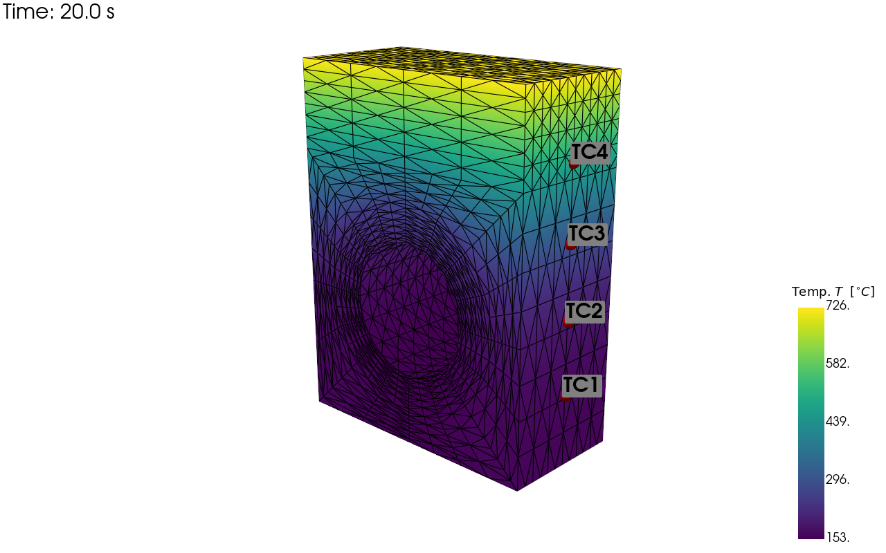
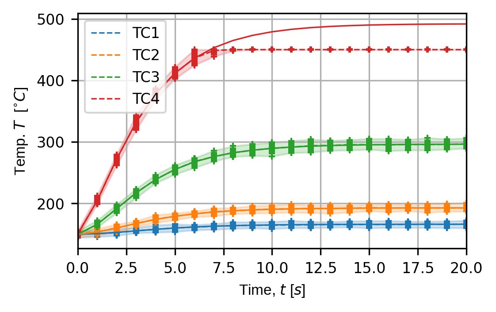
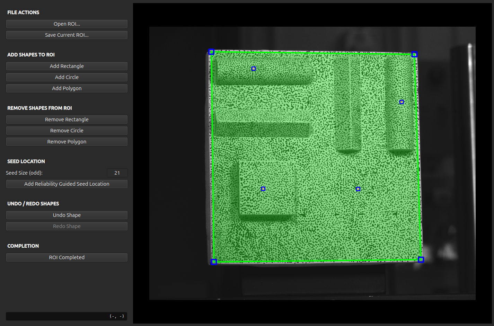
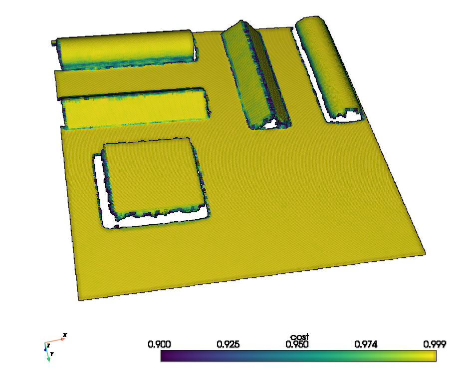
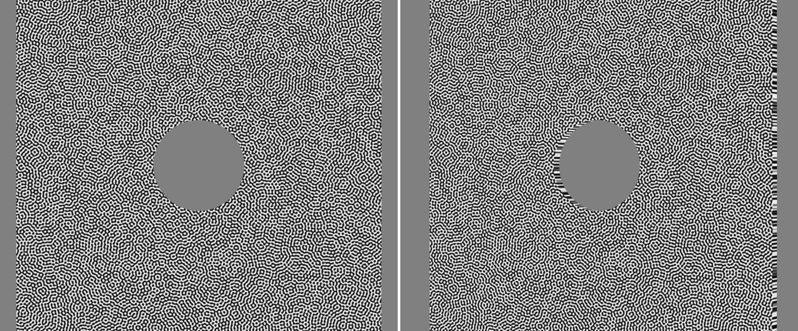
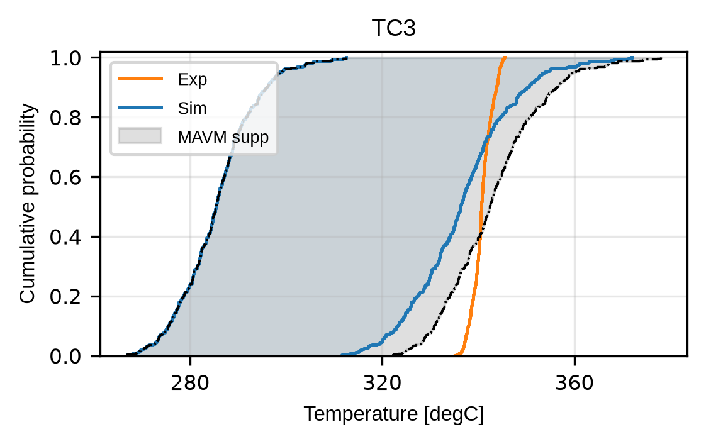
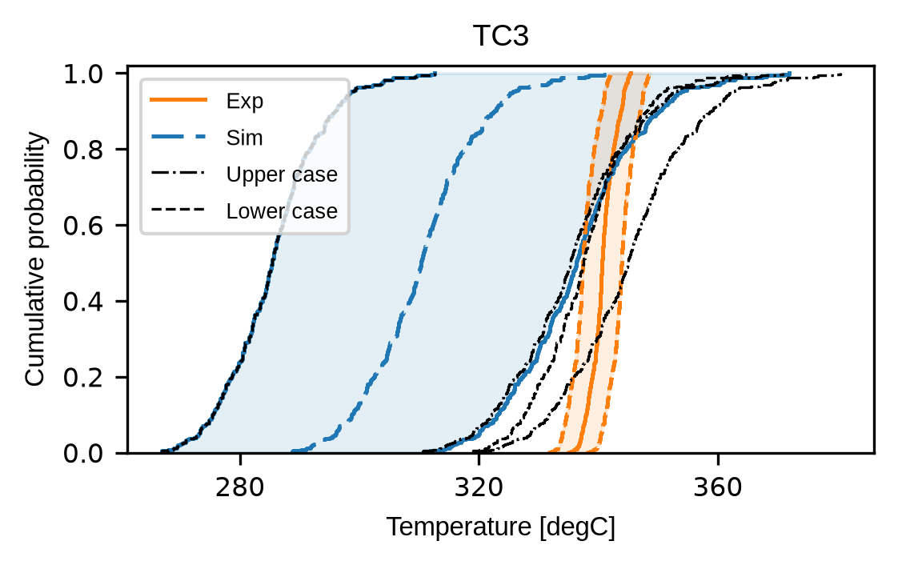
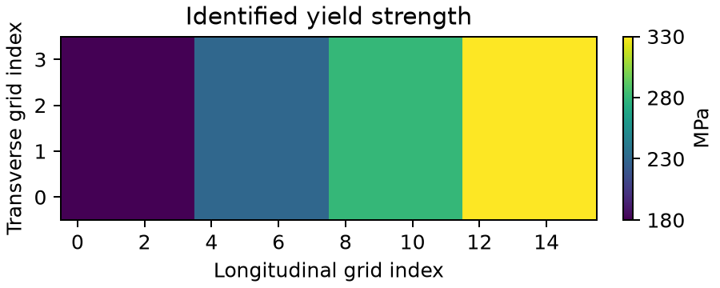

  

<strong>Your virtual engineering laboratory: design experiments, analyse measurements, and iterate with confidence.</strong>

  
  
  
  
  
  

PyVale is a general purpose toolbox for simulation driven experimental design
and experimental mechanics. Build virtual sensor arrays, generate realistic
camera images, analyse DIC measurements, and feed what you learn into the next
experiment. Compare simulations with measurements under uncertainty and
identify material properties from full-field strain and force data. Tools
for sensor placement optimisation and experimental design are under active
development.

## PyVale Design Framework

PyVale connects experimental design, measurement simulation, data analysis simulation validation and uncertainty quantification in an iterative workflow. Its core modules can be used independently or combined to close the loop between simulation and experiment.

| Capability | What it gives you | Documentation |
|:---|:---|:---:|
| **SensorSim** | Virtual sensor arrays, uncertainty models, and repeated simulated experiments | [Examples](https://computer-aided-validation-laboratory.github.io/pyvale/examples/examples_basics_sensorsim.html) · [Guide](https://computer-aided-validation-laboratory.github.io/pyvale/guide_user/guide_sensorsim.html) |
| **DIC** | Two dimensional and stereo correlation, shape reconstruction, displacement, and strain | [Examples](https://computer-aided-validation-laboratory.github.io/pyvale/examples/examples_dic.html) · [Guide](https://computer-aided-validation-laboratory.github.io/pyvale/guide_user/guide_dic.html) |
| **Render** | Synthetic camera images, deforming meshes, and optical realism | [Examples](https://computer-aided-validation-laboratory.github.io/pyvale/examples/examples_render3d.html) · [UV Examples](https://computer-aided-validation-laboratory.github.io/pyvale/examples/examples_renderuvs.html) |
| **Validation** | Simulation-to-experiment comparisons and validation metrics under uncertainty | [Examples](https://computer-aided-validation-laboratory.github.io/pyvale/examples/examples_valid.html) · [Guide](https://computer-aided-validation-laboratory.github.io/pyvale/guide_user/guide_valid.html) |
| **VFM** | Identification of homogeneous and spatially varying material properties from strain and force histories | [Examples](https://github.com/Computer-Aided-Validation-Laboratory/pyvale/tree/main/src/pyvale/examples/vfm) |

## Core Capabilities

### SensorSim · simulate measurements and uncertainty

Create virtual thermocouples, strain gauges, and other sensor arrays on
multiphysics simulations. Model systematic and random uncertainty, repeat
virtual experiments, and inspect the resulting measurement distributions.

[**SensorSim examples**](https://computer-aided-validation-laboratory.github.io/pyvale/examples/examples_basics_sensorsim.html) · [**User guide**](https://computer-aided-validation-laboratory.github.io/pyvale/guide_user/guide_sensorsim.html)

| Sensor locations | Simulated sensor traces |
|:---:|:---:|
|  |  |

### DIC · analyse deformation from images

Run two dimensional and stereo digital image correlation on synthetic or
experimental images. Define regions of interest, correlate large image sets,
reconstruct surfaces, and calculate displacement and strain.

[**DIC examples**](https://computer-aided-validation-laboratory.github.io/pyvale/examples/examples_dic.html) · [**User guide**](https://computer-aided-validation-laboratory.github.io/pyvale/guide_user/guide_dic.html)

| Stereo region of interest | Reconstructed shape |
|:---:|:---:|
|  |  |

### Render · build virtual camera experiments

Render deforming finite element meshes through the verified Riley rasteriser or
the optional Blender backend. Configure camera geometry, distortion, point
spread functions, textures, stereo pairs, and physically meaningful speckle
scales.

[**Render examples →**](https://computer-aided-validation-laboratory.github.io/pyvale/examples/examples_render3d.html) · [**UV mapping examples →**](https://computer-aided-validation-laboratory.github.io/pyvale/examples/examples_renderuvs.html)

  

### Validation · compare simulation with experiment

Compare simulation predictions with experimental measurements under
uncertainty. Use validation metrics to quantify discrepancies in scalar
observables and time histories, then inspect where the predictions and
measurements differ.

[**Validation examples**](https://computer-aided-validation-laboratory.github.io/pyvale/examples/examples_valid.html) · [**User guide**](https://computer-aided-validation-laboratory.github.io/pyvale/guide_user/guide_valid.html)

| Thermocouple validation envelope | Weighted temperature distributions |
|:---:|:---:|
|  |  |

### VFM · identify material properties from full-field measurements

Use the Virtual Fields Method to identify elastoplastic properties from
full-field strain and measured force histories. Fit uniform properties or
estimate how yield strength varies across a specimen using slice-wise
identification.

[**VFM examples**](https://github.com/Computer-Aided-Validation-Laboratory/pyvale/tree/main/src/pyvale/examples/vfm)

  

## Install

PyVale supports Python 3.11 and newer. Most users will use Riley as their rendering engine for image simulation however, if you need path tracing then Blender integration requires Python 3.13 and the optional Blender dependencies.

| Platform | Install commands |
|:---|:---|
| pip | `pip install pyvale` |
| uv | `uv add pyvale` |
| Blender tools | `pip install "pyvale[blender]"` |

[**Installation guide**](https://computer-aided-validation-laboratory.github.io/pyvale/install/install.html) · [**Browse all examples**](https://computer-aided-validation-laboratory.github.io/pyvale/examples/examples.html) · [**Open the documentation**](https://computer-aided-validation-laboratory.github.io/pyvale/)

## Acknowledgements

PyVale is developed by the Computer Aided Validation Team and collaborators.
Its motivation comes from the demanding simulation validation experiments
needed in fusion engineering, while its tools are intended for experimental
mechanics generally.

[Contributors](https://github.com/Computer-Aided-Validation-Laboratory/pyvale/blob/main/CONTRIBUTORS.md) · [Contributing](https://github.com/Computer-Aided-Validation-Laboratory/pyvale/blob/main/CONTRIBUTING.md) · [Citation](https://computer-aided-validation-laboratory.github.io/pyvale/cite.html) · [MIT license](https://github.com/Computer-Aided-Validation-Laboratory/pyvale/blob/main/LICENSE)
